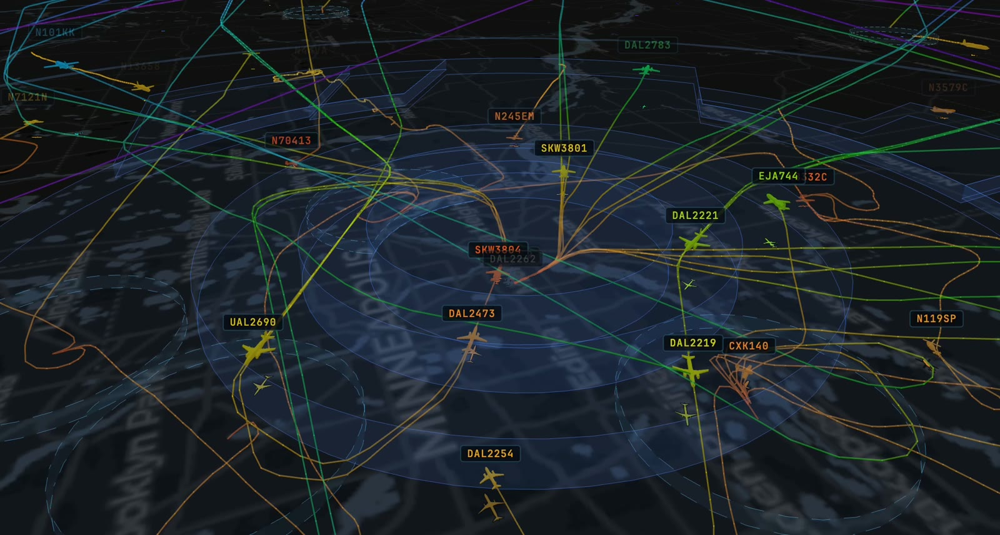
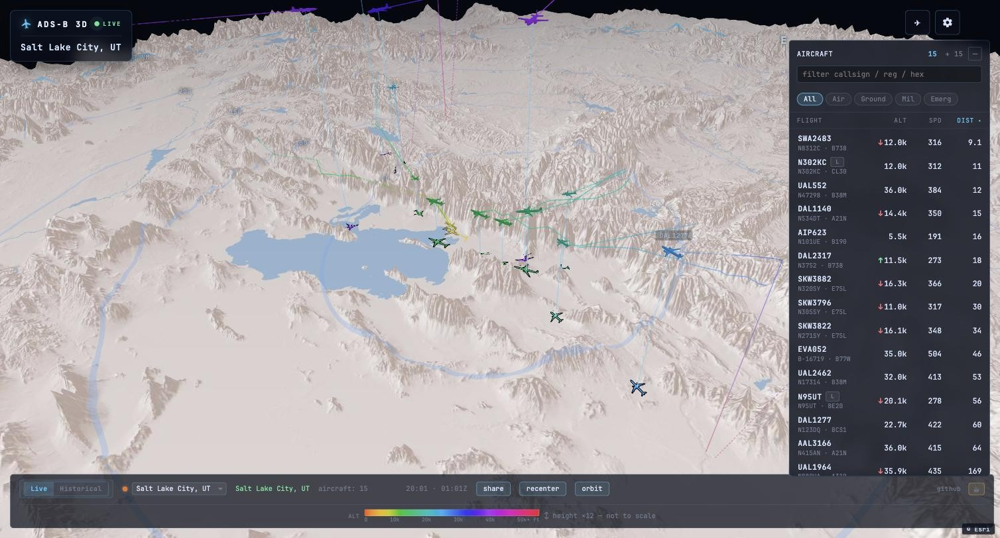

# ADS-B 3D

[](https://github.com/hook-365/adsb-3d/releases)
[](https://github.com/hook-365/adsb-3d/graphs/contributors)
[](https://github.com/hook-365/adsb-3d/issues)

This is a 3D viewer for ADS-B aircraft traffic. Point it at your own
receiver, or pick any city if you don't have one, and you get the
aircraft over real terrain, with airspace and weather radar drawn in 3D
around them. If you run your own receivers you also get historical
playback and ACARS. It runs on your desktop, your phone, and, with a
headset, your coffee table.

It works with anything that publishes readsb's `aircraft.json`: tar1090,
ultrafeeder, dump1090-fa, readsb-protobuf, that kind of thing.

**[Live demo](https://adsb3d.hook.technology)**: this is my own instance, so you can go fly around before you install anything.

[](https://github.com/hook-365/adsb-3d/releases/download/v0.14.0/adsb-3d-airspace.mp4)

Click the image for a short clip.

## Quick start

You need Docker with Compose v2, and a feeder that's already publishing
`aircraft.json`. After that it's one service:

```yaml
services:
  adsb-3d:
    image: ghcr.io/hook-365/adsb-3d:latest
    ports: ["8086:80"]
    environment:
      - LATITUDE=45.0000
      - LONGITUDE=-90.0000
      - ALTITUDE=1000
      - LOCATION_NAME=My Station
      - FEEDER_URL=http://ultrafeeder
```

Run `docker compose up -d`, open `http://localhost:8086/`, and your
aircraft should show up within a few seconds.

If the page loads but stays empty, it's almost always `FEEDER_URL`. **It
has to be reachable from inside the container.** A bare service name like
`http://ultrafeeder` only resolves if adsb-3d shares a Docker network
with your feeder. If it doesn't, use the feeder's host IP and port, like
`http://192.168.1.50:8080`. Check `docker logs adsb-3d` if you're not
sure. The container also reports `unhealthy` until it can reach the
feeder.

## Features



- **Live traffic** as 3D aircraft shapes with trails, altitude colours
  and a detail card (photo, route, airframe, what the aircraft is doing).
- **3D terrain and basemaps**: OpenStreetMap, topo, satellite, FAA charts
  and CARTO, with an altitude scale you can exaggerate.
- **Any city**: point the scope at about 85 world cities, 3,100 US cities
  or 6,000 airports through a community aggregator.
- **3D airspace** (US): Class B, C and D, special use airspace and live
  TFRs as volumes, each with an info card.
- **Airports** (procedures US only): runways, ground detail, weather-coloured
  labels, METAR and TAF, frequencies, published approaches, arrivals and
  departures.
- **Weather**: precipitation radar anywhere; in the US, NOAA radar as 3D
  storm volumes with freezing level, hail and lightning.
- **Navigation data** (US): airways, navaids, fixes, centre boundaries,
  refueling tracks, pilot reports, winds aloft.
- **Historical playback**: scrub the last hour, day or week, with a 3D
  airway-density heatmap.
- **ACARS**: decoded messages on the map and on each aircraft's card.
- **Alerts**: emergency squawks, a watchlist and military traffic.
- **VR and AR**: a walkable diorama on a WebXR headset.
- **Also**: several receivers in one picker, a free-fly camera, five
  themes, English, German and Spanish, keyboard and screen reader support.

That's the short version. The full list, with screenshots, is in
[docs/FEATURES.md](docs/FEATURES.md).

### What needs more than the one container

The quick start gets you live traffic, terrain, airspace, airports and
the precipitation radar. Everything else is optional, and it stays off
until you turn it on:

| Feature | Needs |
|---|---|
| Explore any city | `EXPLORE_PROVIDER` (a free aggregator; one of them wants a free key) |
| Winds aloft | `ENABLE_WINDS_ALOFT` |
| Historical playback and heatmap | `track-service` and TimescaleDB |
| ACARS | `acars-service` and your own acarshub feed |
| 3D storms and the other NOAA layers | `weather-service` |
| VHF voice scanner | an external voice stack, see [docs/VOICE.md](docs/VOICE.md) |

When you want any of those, copy `.env.example` to `.env` and start from
`docker-compose.example.yml`. Everything in that table is already in
there, you just uncomment it.

## VR & AR

Put the airspace on your desk. With a WebXR headset the scope turns into
a diorama you can walk around. You can orbit an aircraft, fly through
the traffic, change settings from a menu on your wrist, or go into AR
and set the whole map down on a real table.

https://github.com/user-attachments/assets/a8a1f6ba-8fe8-4c3b-ad88-d2dae76e2281

That was recorded on a Quest 3 by [@tyzbit](https://github.com/tyzbit),
who has hardware-tested every iteration of this. The
[full-length demo](https://github.com/hook-365/adsb-3d/releases/download/v0.6.0/ADS-B-3D-VR-AR-demo.mp4)
is attached to the v0.6.0 release.

## Documentation

| | |
|---|---|
| [Features](docs/FEATURES.md) | Every layer and panel, with screenshots |
| [Configuration](docs/CONFIGURATION.md) | Every environment variable |
| [Feeds](docs/FEEDS.md) | Several receivers, and the Explore providers |
| [Controls](docs/CONTROLS.md) | Camera modes, mouse and keyboard |
| [Reverse proxy](docs/REVERSE-PROXY.md) | Subdomain or subpath behind nginx, Traefik, Caddy, Apache or NPM |
| [Voice scanner](docs/VOICE.md) | The optional VHF airband scanner |
| [Upgrading](docs/UPGRADING.md) | Upgrade notes and how versions work |
| [Development](docs/DEVELOPMENT.md) | Architecture, dev workflow, regenerating the bundled data |
| [Changelog](CHANGELOG.md) | What changed in each release |

## Built with the community

- **[@tyzbit](https://github.com/tyzbit)**: asked for VR ([#6](https://github.com/hook-365/adsb-3d/issues/6)) and then Quest-3-tested every VR/AR release with annotated videos; the altitude-scale idea ([#8](https://github.com/hook-365/adsb-3d/issues/8)).
- **[@ValkyrieUK](https://github.com/ValkyrieUK)**: the full-stack Docker integration tests and CI ([#9](https://github.com/hook-365/adsb-3d/issues/9)), plus a retention bug every fresh install had.
- **[@unLieb](https://github.com/unLieb)**: scoped the localization architecture ([#10](https://github.com/hook-365/adsb-3d/issues/10)); German native review.
- **[@rknobbe](https://github.com/rknobbe)**: 3D terrain ([#7](https://github.com/hook-365/adsb-3d/issues/7)), tab-scoped settings ([#12](https://github.com/hook-365/adsb-3d/issues/12)), real balloons and airships ([#13](https://github.com/hook-365/adsb-3d/issues/13)), routes on live-only installs ([#15](https://github.com/hook-365/adsb-3d/issues/15)).
- **[@auggiesoft](https://github.com/auggiesoft)**: contributed smooth motion ([#14](https://github.com/hook-365/adsb-3d/pull/14)).
- **[@dirkhh](https://github.com/dirkhh)**: runs [adsb.im](https://adsb.im), the source of every route here, and asked for the batching that became the shared route cache ([#16](https://github.com/hook-365/adsb-3d/issues/16)). If routes are useful to you, [support adsb.im](https://adsb.im).

- **The community aggregators behind Explore**: [FlyItalyADSB](https://flyitalyadsb.com), [adsb.lol](https://adsb.lol), [adsb.fi](https://adsb.fi) and [airplanes.live](https://airplanes.live) each publish a free "aircraft near a point" API built from receivers that hobbyists run at home. Pick any city in the world because they share what they collect. If you have a receiver, feed them: it costs nothing and some of them grant higher limits to feeders.

Want your name here? Issues with reproduction steps, hardware testing,
and translations count just as much as code.

## Credits

None of the data here is mine, and this only works because other people
share theirs. Aircraft shapes, colours and refueling tracks come from
[tar1090](https://github.com/wiedehopf/tar1090). Routes come from
[adsb.im](https://adsb.im), photos from planespotters.net. Explore traffic
comes from [FlyItalyADSB](https://flyitalyadsb.com),
[adsb.lol](https://adsb.lol), [adsb.fi](https://adsb.fi) and
[airplanes.live](https://airplanes.live). Airspace, procedures and TFRs
come from the FAA; weather from [NOAA MRMS](https://mrms.ncep.noaa.gov/),
[aviationweather.gov](https://aviationweather.gov/data/api/),
[RainViewer](https://www.rainviewer.com/) and
[Open-Meteo](https://open-meteo.com). Airports come from
[OurAirports](https://ourairports.com/data/), cities from
[GeoNames](https://www.geonames.org), and maps from OpenStreetMap, ESRI,
OpenTopoMap, [CARTO](https://carto.com/attributions) and
[VFRMap](https://vfrmap.com).

The licences and terms for each of them are in
[docs/CREDITS.md](docs/CREDITS.md). Please don't navigate with any of it.

## License

Source code is MIT (see `LICENSE`). Data taken from tar1090
(`frontend/src/aircraft/shapes-data.json` and
`frontend/src/world/refueling-data.json`) is GPL v2+ per upstream. If
you redistribute the built app, GPL governs those components.
