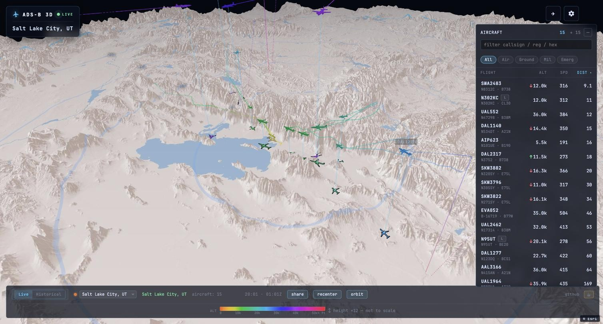
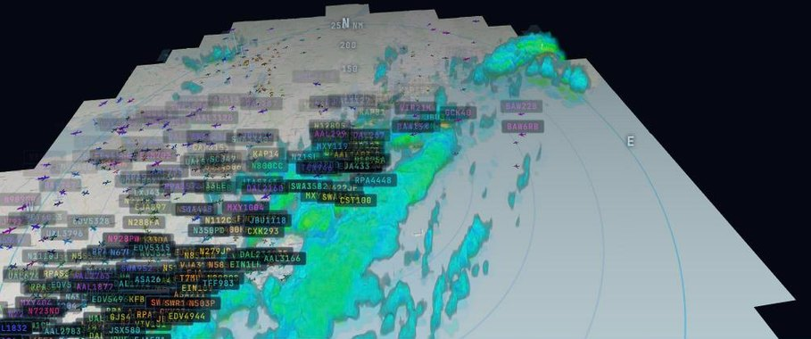
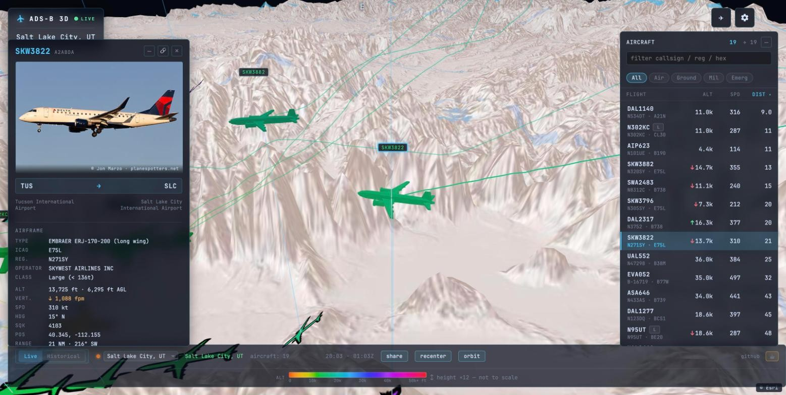
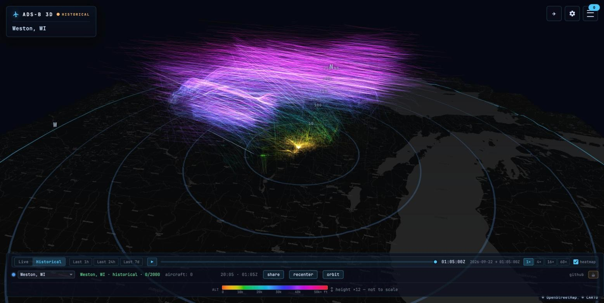
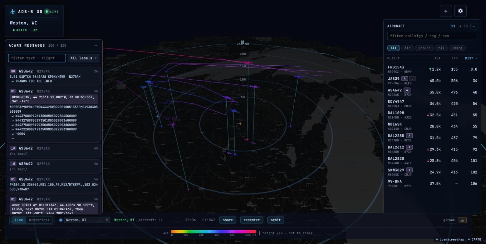
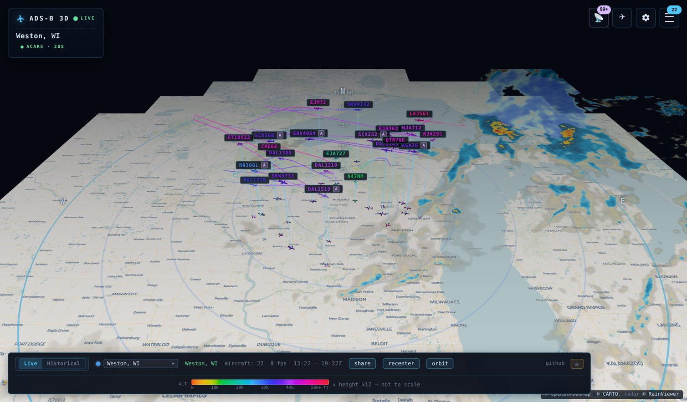
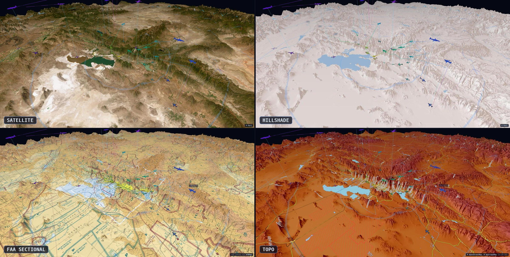

# ADS-B 3D

[](https://github.com/hook-365/adsb-3d/releases)
[](https://github.com/hook-365/adsb-3d/graphs/contributors)
[](https://github.com/hook-365/adsb-3d/issues)

Real-time 3D visualization of ADS-B aircraft, with historical playback,
3D airway-density heatmaps, optional ACARS message decoding, and NOAA
radar as 3D storm volumes, surface precipitation, freezing level, severe
cells and lightning. Watch your own receiver, or pick any city in the
world through a community aggregator. One Docker image: it serves the
viewer and reverse-proxies your existing ADS-B feeder. Runs on your
desktop, your phone, and, with a headset, your coffee table.

Works with anything that publishes readsb's `aircraft.json` — tar1090,
ultrafeeder, dump1090-fa, readsb-protobuf, and so on.

**[Live demo →](https://adsb3d.hook.technology)** — explore a running instance in your browser.



## Built with the community

- **[@tyzbit](https://github.com/tyzbit)**: asked for VR ([#6](https://github.com/hook-365/adsb-3d/issues/6)) and then Quest-3-tested every VR/AR release with annotated videos; the altitude-scale idea ([#8](https://github.com/hook-365/adsb-3d/issues/8)).
- **[@ValkyrieUK](https://github.com/ValkyrieUK)**: the full-stack Docker integration tests and CI ([#9](https://github.com/hook-365/adsb-3d/issues/9)), plus a retention bug every fresh install had.
- **[@unLieb](https://github.com/unLieb)**: scoped the localization architecture ([#10](https://github.com/hook-365/adsb-3d/issues/10)); German native review.
- **[@rknobbe](https://github.com/rknobbe)**: 3D terrain ([#7](https://github.com/hook-365/adsb-3d/issues/7)), tab-scoped settings ([#12](https://github.com/hook-365/adsb-3d/issues/12)), real balloons and airships ([#13](https://github.com/hook-365/adsb-3d/issues/13)), routes on live-only installs ([#15](https://github.com/hook-365/adsb-3d/issues/15)).
- **[@auggiesoft](https://github.com/auggiesoft)**: contributed smooth motion ([#14](https://github.com/hook-365/adsb-3d/pull/14)).
- **[@dirkhh](https://github.com/dirkhh)**: runs [adsb.im](https://adsb.im), the source of every route here, and asked for the batching that became the shared route cache ([#16](https://github.com/hook-365/adsb-3d/issues/16)). If routes are useful to you, [support adsb.im](https://adsb.im).

- **The community aggregators behind Explore**: [FlyItalyADSB](https://flyitalyadsb.com), [adsb.lol](https://adsb.lol), [adsb.fi](https://adsb.fi) and [airplanes.live](https://airplanes.live) each publish a free "aircraft near a point" API built from receivers that hobbyists run at home. Pick any city in the world because they share what they collect. If you have a receiver, feed them: it costs nothing and some of them grant higher limits to feeders.

Want your name here? Issues with reproduction steps, hardware testing,
and translations count just as much as code.

## What's new



- **v0.13.0** (2026-11-06): **3D weather** from NOAA MRMS through one optional sidecar: storm volumes that end at their measured echo tops, surface precipitation on the radar colour ramp, a freezing-level sheet where it rains, severe hail and rotation marked on the ground, lightning flashes, and storm top and strike rate next to a selected aircraft. **Global Explore**: pick any of ~85 cities and watch its traffic through a community aggregator (FlyItalyADSB, adsb.lol, adsb.fi or airplanes.live). **Free camera** and a spin control with direction and speed; deselecting returns to the view you had. Docked panel style by default, Glass still there; RainViewer radar outside US coverage; emergency toasts with the squawk on the label; a what's-new note once per version; reduced-motion defaults; 24 h shared route cache; vertical scale defaults to 4x.
- **v0.12**: shared route cache and batched, identified requests to adsb.im ([#16](https://github.com/hook-365/adsb-3d/issues/16)); one `VERSION` everywhere; daily update check with an in-app badge.
- **v0.11**: smooth motion between position updates (by [@auggiesoft](https://github.com/auggiesoft)); routes on live-only installs with an "Unverified" mark when they do not fit the aircraft's position; per-tab settings; upright balloons and airships.
- **v0.10**: AR diorama matured: placeable, resizable clip box, auto-orbit, follow-random-aircraft, high-res basemap option.
- **v0.9**: ACARS panel on the map with decoded messages and position pings; CARTO basemaps browser-direct under your own key; the hardening release (security headers, rate limiting, 750+ tests in CI).
- **v0.7**: real 3D aircraft bodies built from each tar1090 silhouette.

Full history in [CHANGELOG.md](CHANGELOG.md) and on the
[releases page](https://github.com/hook-365/adsb-3d/releases).

## What you get

- **Live mode**: per-second updates, tar1090 altitude colours on cones, trails, ground icons and labels. Click an aircraft for photo, route, airframe and autopilot data. Filter pills (`All / Air / Ground / Mil / Emerg`) drive the list and the scene. Mobile-friendly.



- **Historical mode** (track-service + TimescaleDB): scrub the last 1h / 24h / 7d at 1x to 60x, with a 3D airway-density overlay that draws every flight path at its real altitude.



- **ACARS** (acars-service): a searchable message panel, per-aircraft messages in the detail card with an OOOI phase chip, an `A` badge on label and list row, and decoded summaries for position reports, arrivals, weather and CPDLC/ADS-C/AFN (details in [acars-service/README.md](acars-service/README.md#message-decoding)). Messages with coordinates drop a position ping on the map, even beyond ADS-B range.



- **Weather radar**: [RainViewer](https://www.rainviewer.com/) precipitation over any basemap, refreshed every few minutes, proxied and cached by nginx, credited on screen while on.



- **3D storms** (weather-service, US only): NOAA MRMS merged reflectivity, 33 altitude slices cropped around whichever feed is active and raymarched as translucent storm volumes so you can see aircraft route around cells. One sidecar serves every feed; refreshes every 5 minutes; browsers get a few hundred KB at most. Cells end at their real **echo tops**, and the detail panel shows the storm top next to a nearby aircraft's altitude.
- **More MRMS layers** (same sidecar, each a toggle): **surface precipitation** by rate and type (rain, snow, convective, hail) in place of RainViewer inside US coverage; a translucent **freezing level** sheet at the 0 °C height, cut to where it is raining; **severe cells** ringed and labelled from hail size and low-level rotation; **lightning** flashes from NLDN density, with the strike rate in the detail panel.

- **Emergency alerts**: squawk 7500 / 7600 / 7700 raises a toast (click to select), a red label with the squawk beside the flight name, and a pulsing ground ring. Live only, no sound.
- **Panel style**: *Docked* (default) attaches solid panels to the edges with the map credit inside the footer; *Glass* floats cards over the map.
- **Multi-feed**: several receivers, a feed picker in the status bar, in-place switching.
- **Explore any city**: pick from about 85 cities worldwide and watch that area's traffic from a global aggregator (FlyItalyADSB, adsb.lol, adsb.fi or airplanes.live), with terrain and basemaps as usual. See [Explore](#explore-any-city).
- **Free camera**: the footer *fly* button swaps the orbit for a free-flying eye: drag to look, WASD or arrows to move, R/F up and down, Shift for speed. Deselecting an aircraft returns the orbit camera to the view you had before.
- **Themes**: Midnight Glass, Daylight, Sectional Chart, Phosphor CRT, High Contrast, or `Auto` from your system preference. The 3D scene re-tints live.
- **Languages**: English, German, Spanish (machine-drafted pending native review; corrections welcome).
- **3D terrain** (opt-in): the basemap rises to real elevation with rings, markers and ground icons draped over it; free data, no key. An **altitude scale** slider warps the vertical axis toward pattern or flight-level detail.
- **VR / AR**: WebXR with laser-pointer controllers, a wrist menu with full settings parity, comfort locomotion, AR scope placement and the diorama clip box. Quest 3 tested; demo in [VR & AR](#vr--ar). Side-by-side stereo for anything without WebXR.
- **Basemaps**: OpenStreetMap, OpenTopoMap, ESRI relief and satellite, FAA charts, and CARTO Dark / Voyager with your own free `CARTO_API_KEY` (browser-direct, as [their terms](https://carto.com/legal/basemap-terms/) require). Attribution always on screen. Optional high-res mode fetches one zoom level deeper.



- **Keyboard and screen readers**: the aircraft list is a real listbox with arrow-key navigation, proper roles, a keyboard-operable ACARS panel, and a throttled live count.

## Prerequisites

- Docker Engine 20+ and Docker Compose v2
- An ADS-B feeder already publishing `aircraft.json` (tar1090,
  ultrafeeder, dump1090-fa, readsb-protobuf, …)

## Quick start

```yaml
services:
  adsb-3d:
    image: ghcr.io/hook-365/adsb-3d:latest
    ports: ["8086:80"]
    environment:
      - LATITUDE=45.0000
      - LONGITUDE=-90.0000
      - ALTITUDE=1000
      - LOCATION_NAME=My Station
      - FEEDER_URL=http://ultrafeeder
```

`docker compose up -d`, then open `http://localhost:8086/` — your
aircraft should appear within a few seconds.

**`FEEDER_URL` must be reachable from inside the container.** A bare
service name like `http://ultrafeeder` only resolves if adsb-3d shares a
Docker network with your feeder. If it doesn't, use the feeder's host IP
and port — e.g. `http://192.168.1.50:8080`. If the page loads but stays
empty, this is almost always why: check `docker logs adsb-3d` (the
container reports `unhealthy` until it can reach the feeder).

For historical playback, ACARS, 3D storms, or the voice scanner, copy
`.env.example` to `.env` and start from `docker-compose.example.yml`
in the repo root. Both have track-service, ACARS, weather-service, and
TimescaleDB ready to uncomment; the `ENABLE_*` flags below switch each on.

## VR & AR

Put the airspace on your desk. With a WebXR headset the scope becomes a
walkable diorama: orbit a selected aircraft, free-fly through the
traffic, change settings from a wrist menu, or enter AR and drop the map
onto real furniture with a glance and a trigger pull. Diorama clipping
keeps it desk-sized — the map pans beneath a fixed, resizable open-top
box — and auto-orbit slowly circles the scope (or your followed
aircraft) like a live model.

https://github.com/user-attachments/assets/a8a1f6ba-8fe8-4c3b-ad88-d2dae76e2281

Demo recorded on a Quest 3 by [@tyzbit](https://github.com/tyzbit), who
hardware-tested every iteration of these features. The
[full-length demo](https://github.com/hook-365/adsb-3d/releases/download/v0.6.0/ADS-B-3D-VR-AR-demo.mp4)
is attached to the v0.6.0 release.

## Reverse proxy

adsb-3d runs on a subdomain or a subpath (`example.com/3d`). The
entrypoint auto-detects the subpaths `/3d`, `/adsb`, and `/adsb-3d` when
your proxy passes the prefix through; set `BASE_PATH` if the proxy strips
the prefix or uses a different path. Worked configs for nginx, Traefik,
Caddy, Apache, and Nginx Proxy Manager are in
[docs/REVERSE-PROXY.md](docs/REVERSE-PROXY.md).

## Multi-feed

Define each feed with flat `FEEDN_*` env vars — the entrypoint
synthesises the rest:

```env
FEED1_NAME=Home Station
FEED1_LAT=45.0000
FEED1_LON=-90.0000
FEED1_ALT=1000                # feet MSL, like all altitudes here
FEED1_ACARS=true              # optional

FEED2_NAME=Remote Site
FEED2_URL=192.0.2.10:8086     # host:port of another adsb-3d instance
FEED2_LAT=43.0000
FEED2_LON=-89.0000
FEED2_COLOR=#ff8c4c           # optional
```

Slot 1 is always local — `FEED1_URL` is ignored. Slots 2+ point at other
adsb-3d instances and the entrypoint wires up the nginx proxy blocks.
Parsing stops at the first missing `FEEDN_NAME`.

### Explore: any city

Set `EXPLORE_PROVIDER` and the feed picker gains an *Explore* entry with a
searchable city list (Rome, London, Tokyo, New York and about 80 more,
grouped by region). The scene recentres on the chosen city and shows that
area's traffic from the aggregator's worldwide feed, with terrain and
basemaps as usual. Live only: no history, ACARS or voice for that feed,
and routes are looked up only for the aircraft you select.

| `EXPLORE_PROVIDER` | Key | Notes |
|---|---|---|
| `flyitalyadsb` | `EXPLORE_API_KEY`, free and self-serve at [flyitalyadsb.com](https://flyitalyadsb.com/en/data/api/) | 30 requests/min on the free plan; feeders get Pro limits on the same key. Data is CC BY-SA 4.0 |
| `adsb.lol` | none | No published limit ("dynamic"); data is ODbL 1.0; feeding them is encouraged |
| `adsb.fi` | none | 1 request/s per IP; personal, non-commercial use only; cite with a link |
| `airplanes.live` | none | No published limit; site terms are non-commercial |

Any key stays in nginx. nginx rewrites the browser's `?lat=&lon=` into the
provider's radius query, adds the key and User-Agent, and caches each
city for the poll interval, so any number of viewers of one city cost one
upstream request per interval. The default `EXPLORE_POLL_S=10` keeps even
the FlyItalyADSB free plan well inside its limit with several cities
open; smooth motion fills the gaps. Each city costs at most six upstream
requests a minute however many people are watching it, and nothing from
the aggregators is stored: routes are looked up on selection only and the
history collector never sees Explore traffic. The attribution line credits
the provider while the feed is active; keep it visible, it is a licence
condition for some of them.

## Environment variables

**Core:**

| Variable | Default | Purpose |
|---|---|---|
| `LATITUDE` / `LONGITUDE` / `ALTITUDE` | — | Receiver location; `ALTITUDE` in **feet** MSL (as are all `FEEDN_ALT`) |
| `LOCATION_NAME` | `Home` | Display name |
| `FEEDER_URL` | `http://ultrafeeder` | Anything publishing `/data/aircraft.json` — must be reachable from the container |
| `ENABLE_HISTORICAL` | `false` | Historical playback UI (needs track-service) |
| `ENABLE_ACARS` | `false` | ACARS panel (needs acars-service) |
| `ENABLE_WEATHER3D` | `false` | 3D storm volumes and the other MRMS layers, US only (needs weather-service) |
| `WEATHER_FIELDS` (weather-service) | `echotop18,echotop30,freezing,preciprate,preciptype,mesh,rotation,lightning` | Which MRMS 2-D products the sidecar fetches; add `bbtop,bbbottom` for the melting layer (15 MB each per fetch), or trim the list |
| `ENABLE_VOICE` | `false` | VHF voice scanner panel (see [docs/VOICE.md](docs/VOICE.md)) |
| `EXPLORE_PROVIDER` | — | `flyitalyadsb`, `adsb.lol`, `adsb.fi` or `airplanes.live`; adds the *Explore* feed (pick any city). See [Explore](#explore-any-city) |
| `EXPLORE_API_KEY` | — | API key for `flyitalyadsb` (setting it alone selects that provider) |
| `EXPLORE_POLL_S` | `10` | Seconds between Explore polls and the per-city cache window; a free key allows 30 requests a minute |
| `ENABLE_TERRAIN` | `true` | Deploy-level 3D-terrain kill switch (users still opt in per-browser) |
| `ENABLE_UPDATE_CHECK` | `true` | The container asks GitHub once a day for the latest release and the settings panel shows a badge when it is newer. Runs server-side only (one request per deployment per day, no viewer IPs); `false` disables it entirely |
| `HIDE_TOWER` | `false` | Hide the home tower marker |
| `TRACK_API_HOST` | `track-service:8000` | nginx upstream |
| `ROUTE_CACHE_TTL_SECONDS` (track-service) | `86400` | How long the shared route cache keeps an answer before asking adsb.im again |
| `ROUTE_MIN_INTERVAL_SECONDS` (track-service) | `180` | Minimum spacing between route requests to adsb.im; newly seen callsigns coalesce until it passes |
| `ROUTE_API_CONTACT` (adsb-3d and track-service) | — | Contact (email or site) sent to adsb.im and tile providers in the User-Agent (`adsb-3d/<version> (+repo; contact)`); they ask for one. Unset = no contact sent, warning at start |
| `ACARS_API_HOST` | `acars-service:8000` | nginx upstream |
| `WEATHER_API_HOST` | `weather-service:8000` | nginx upstream for `/weather-api/` |
| `VOICE_EVENTS_HOST` | — | nginx upstream for `/voice/calls` + `/voice/ws` — what the frontend uses |
| `VOICE_STREAM_HOST` | — | required when voice is on; point at any reachable `host:port` (legacy Icecast block, not played by the frontend) |
| `CARTO_API_KEY` | — | Free [CARTO basemaps key](https://carto.com/basemaps/apikey) that unlocks the Carto Dark and Carto Voyager basemaps. Fetched by the browser directly from CARTO (their terms forbid proxying), one key per deployment. Without it those two entries are hidden and the default basemap falls back to OpenStreetMap |
| `DNS_RESOLVER` | `127.0.0.11` | nginx `resolver` address(es) for upstream lookups; override on runtimes without Docker's embedded DNS (e.g. Kubernetes CoreDNS) |
| `MAP_ZOOM` / `MAP_GRID_SIZE` | `8` / `21` | boot-time tile pre-cache around the station (zoom level / grid width); only active with the `/tiles` volume mounted |

**Multi-feed:** `FEEDN_NAME`, `FEEDN_LAT`, `FEEDN_LON`, `FEEDN_ALT`,
`FEEDN_URL`, `FEEDN_COLOR`, `FEEDN_ACARS` — see [Multi-feed](#multi-feed).
(`FEEDS_CONFIG` accepts the raw JSON feed array directly and skips the
`FEEDN_*` synthesis — see `.env.example` for the shape.)

**Backend services** (`track-service` / `acars-service` / `weather-service`
containers, not the main image — see the compose example):

| Variable | Default | Purpose |
|---|---|---|
| `FEEDER_URL` | `http://ultrafeeder` | same feeder the frontend uses; both services poll it |
| `FEEDER_POLL_SECONDS` | heuristic | live-stream poll cadence override (defaults per feeder type) |
| `COLLECTION_INTERVAL` | `5` | seconds between DB track snapshots (track-service) |
| `RETENTION_DAYS` | `90` | TimescaleDB retention for tracks and ACARS messages |
| `DB_HOST` / `DB_PORT` / `DB_NAME` / `DB_USER` / `DB_PASSWORD` | `timescaledb-adsb` / `5432` / `adsb_tracks` / `adsb` / — | TimescaleDB connection; password has no default on purpose |
| `ACARS_HOST` / `ACARS_PORT` | `acarshub` / `15550` | acarshub / acars_router JSON-over-TCP feed (acars-service); `15550` is the ACARS lane, `15555` VDL Mode 2 |
| `LATITUDE` / `LONGITUDE` (weather-service) | — | optional; pre-warms a pinned storm volume for the local feed at startup. Other feeds are cropped on demand from the viewer's `lat`/`lon` |
| `WEATHER3D_RADIUS_NM` | `250` | half-width of each feed's crop box in nautical miles (weather-service) |
| `WEATHER3D_REFRESH_S` | `300` | seconds between NOAA MRMS downloads (weather-service) |
| `WEATHER3D_LOCATION_TTL_S` | `1800` | drop a feed location nobody asked about for this long; pinned pre-warm never expires (weather-service) |
| `ROUTE_API_CONTACT` (weather-service) | — | contact sent to NOAA in the User-Agent, same as the other services |

ACARS messages are decoded into human-readable summaries (position reports, arrivals, weather requests, and CPDLC/ADS-C/AFN datalink) shown above the raw text; see [acars-service/README.md](acars-service/README.md#message-decoding).
| `STATION_ID` | `adsb-3d` | station identifier stamped on stored ACARS messages |

**Reverse proxy:** `BASE_PATH` overrides the auto-detected subpath
(see [Reverse proxy](#reverse-proxy)). `TRUSTED_PROXY_CIDR` (comma-
separated CIDRs) makes rate limiting key on the real client IP behind
a fronting proxy instead of one shared bucket. `CORS_ALLOW_ORIGIN`
(default empty = no CORS headers) opts a specific origin — or `*` —
back in if another site consumes the API directly.

## Controls

Two camera modes, switched with the footer pill (or Settings → Camera):

- **Orbit** (default): **left-drag** turns around a point, **scroll** zooms,
  **right-drag** pans the view (moves the center point). Selecting an
  aircraft follows it; deselecting eases back to the view you had.
- **Free**: **left-drag** looks around, **WASD** or the arrow keys fly
  relative to where you look, **R / F** (or PageUp / PageDown) go straight
  up and down, **Shift** is fast, **scroll** pushes along the line of sight.

**Spin** in the footer starts a slow auto-orbit and opens a direction and
speed popover; once the hand is still for two seconds the controls fade so
only the orbit is left, and any movement brings them back.

| Key | Action |
|---|---|
| Arrow keys | Pan the view (orbit) or fly (free) |
| `R` | Recenter camera + clear selection (orbit); straight up (free) |
| `/` | Focus the list search box |
| `Esc` | Close settings panel, ACARS panel or a popover |

## Upgrading

Pull the new image and restart; settings and data carry over. From
0.12.2 the settings panel shows an **Update available** badge when a
newer release exists, and the first load after an upgrade shows what
changed.

**Routes (origin / destination) stopped showing?** Releases before
0.12 sent route lookups to [adsb.im](https://adsb.im) one callsign at a
time and may be rate-limited or blocked there. Pull a current image
(`:latest` or `0.12.2`+) and restart; routes come back, and from 0.12.2
the settings panel tells you when a newer release exists. See
[#17](https://github.com/hook-365/adsb-3d/issues/17).

Full detail in [CHANGELOG.md](CHANGELOG.md).

### Versioning

`VERSION` at the repository root is the single source of truth. Every image
copies it at build time and reports it everywhere a version appears: the
settings panel (`v0.12.1`), the `/api` and `/acars-api` root endpoints, the
nginx `User-Agent` sent to adsb.im and tile providers, and track-service's
`adsb-3d/<version> track-service` agent. Images built from a commit that is
not a release tag carry build metadata (`0.12.1+a1b2c3d`, or `+local` for a
local compose build), so a non-release build can never be mistaken for the
published one. Releases are cut with `scripts/release.sh X.Y.Z`; CI refuses
to publish if `VERSION`, `frontend/package.json` and the tag disagree.

## Architecture

```
                ┌──────── browser ────────┐
                │  Vite/TS Three.js app   │
                └───────────┬─────────────┘
                            │
                       nginx (port 80)
                            │
      ┌──────────┬──────────┼──────────┬──────────────┬───────────────┐
      │          │          │          │              │               │
   /data/...  /api/...   /ws/...  /api/feeds/N/...  /acars-api/   /weather-api/
      │          │          │          │              │               │
 ultrafeeder  track-service │   remote adsb-3d   acars-service  weather-service
                  │             instance (slot N)                 (NOAA MRMS)
                  ▼
            TimescaleDB
       (aircraft_positions
        + aircraft_metadata
        + acars_messages)
```

- **`frontend/`** — Vite + TypeScript + Three.js viewer, no framework.
- **`track-service/`** — FastAPI + asyncpg; a live WebSocket diff stream
  plus a TimescaleDB history collector.
- **`acars-service/`** — FastAPI bridge to an acarshub TCP feed.
- **`weather-service/`** — FastAPI sidecar that downloads NOAA MRMS 3D
  reflectivity once and serves a small volume cropped around each feed.
- **`nginx/`** — reverse proxy + static host; `entrypoint.sh` renders the
  config (including per-feed proxy blocks) from env vars at start.

See [CLAUDE.md](CLAUDE.md) for a deeper architecture orientation.

## Development

```sh
cd frontend
npm install
npm run dev         # Vite dev server
npm run typecheck   # tsc, strict
npm run test        # Vitest
npm run build       # → dist/
```

`npm run dev` proxies backend routes to `http://localhost:8080`; override
with `DEV_BACKEND`. To run the full container against an existing backend:

```sh
docker compose -f docker-compose.dev.yml --project-directory . up --build -d
# → http://localhost:8186/
```

## Credits

- **tar1090** ([wiedehopf/tar1090](https://github.com/wiedehopf/tar1090),
  GPL v2+) — SVG aircraft shape catalog and the altitude → color palette.
- **readsb / dump1090-fa** — upstream Mode S/ADS-B decoder.
- **planespotters.net** — aircraft photographs in the detail panel.
- **[adsb.im](https://adsb.im)** — callsign → route resolution, run by
  one person as a hobby service. Lookups are cached and batched to keep
  the load small; please keep it that way if you fork this.
- **[FlyItalyADSB](https://flyitalyadsb.com)** (CC BY-SA 4.0),
  **[adsb.lol](https://adsb.lol)** (ODbL 1.0), **[adsb.fi](https://adsb.fi)**
  (personal, non-commercial) and **[airplanes.live](https://airplanes.live)**
  — community-run aggregators whose radius APIs power the Explore feed,
  one at a time per deployment; credited on screen while active, polled
  at most six times a minute per city, nothing stored.
- **[NOAA MRMS](https://mrms.ncep.noaa.gov/)** — merged 3D reflectivity
  behind the 3D storms, US government public domain; credited on screen.
- **OpenStreetMap, ESRI, OpenTopoMap** — basemap tile providers, proxied
  and cached by the container; credited on screen.
- **[CARTO](https://carto.com/attributions)** — Dark / Voyager basemaps,
  fetched directly by the browser under your own free API key per
  [CARTO's basemap terms](https://carto.com/legal/basemap-terms/)
  (5M tiles/month fair-use, OpenStreetMap + CARTO attribution required,
  no server-side caching).
- **[VFRMap](https://vfrmap.com)** — hosting for FAA Sectional / Helicopter
  / IFR Low / IFR High chart tiles, kept in sync with the FAA 56-day cycle.
  Free non-commercial service; please don't abuse it.

## License

Source code is MIT (see `LICENSE`). Vendored tar1090 data
(`frontend/src/aircraft/shapes-data.json`) is GPL v2+ per upstream — if
you redistribute the built app, GPL governs that component.
