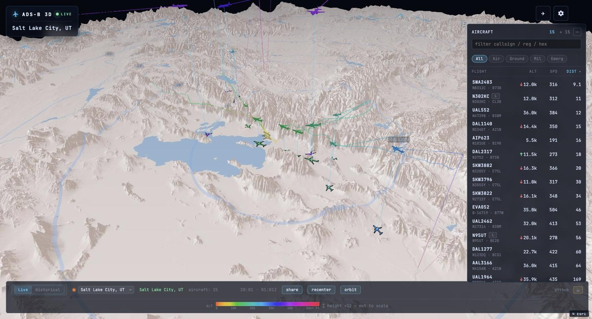
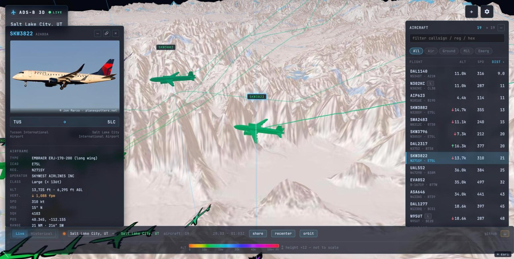
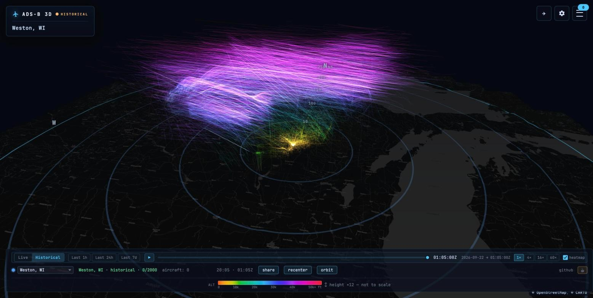
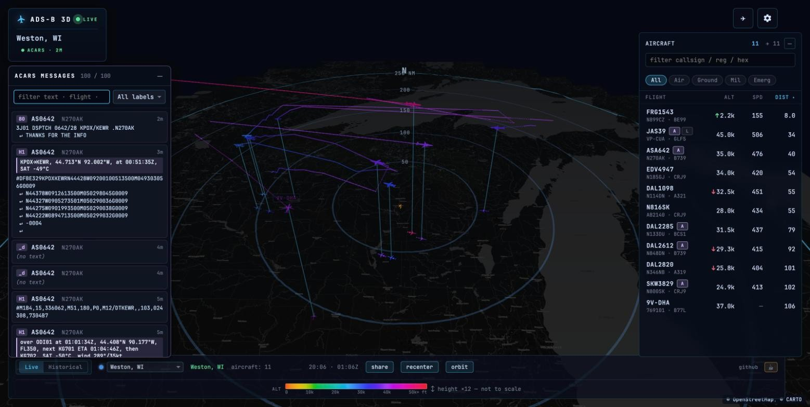
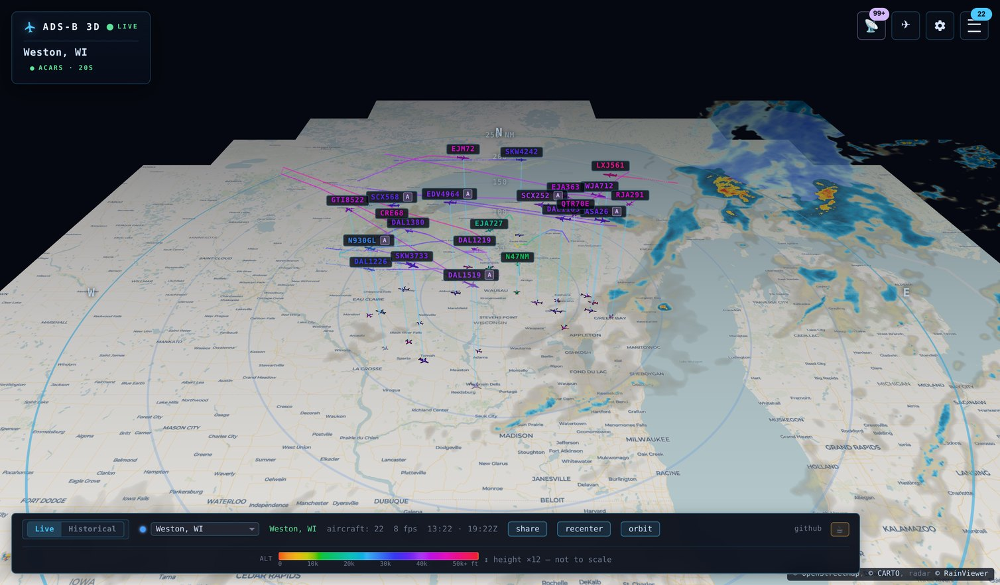
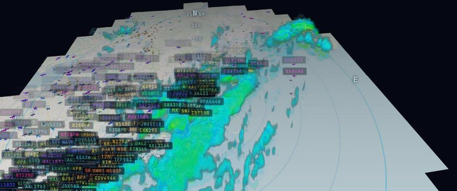
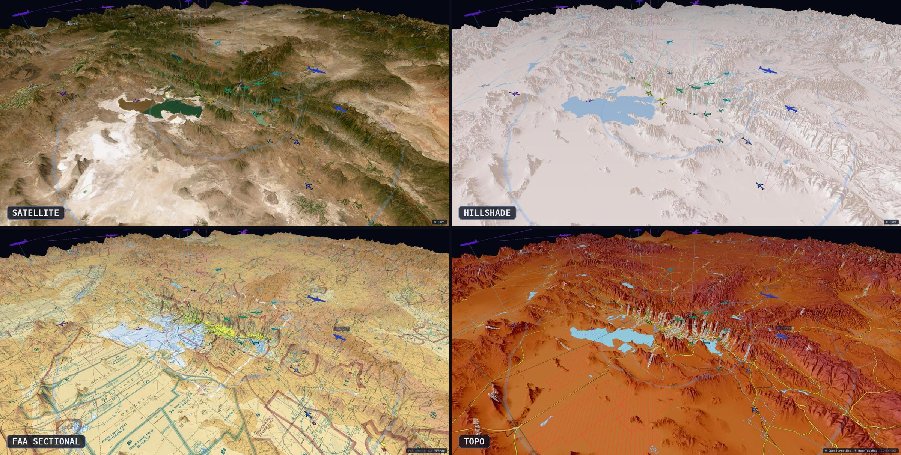

# Features

Everything the viewer can show. Most layers are toggles in the settings panel; the ones that need an extra container or an environment variable say so. Setup for those is in [CONFIGURATION.md](CONFIGURATION.md).

- **Live mode**: per-second updates, tar1090 altitude colours on cones, trails, ground icons and labels. Click an aircraft for photo, route, airframe and autopilot data. Filter pills (`All / Air / Ground / Mil / Emerg`) drive the list and the scene. Mobile-friendly.

- **Historical mode** (track-service + TimescaleDB): scrub the last 1h / 24h / 7d at 1x to 60x, with a 3D airway-density overlay that draws every flight path at its real altitude.

- **ACARS** (acars-service): a searchable message panel, per-aircraft messages in the detail card with an OOOI phase chip, an `A` badge on label and list row, and decoded summaries for position reports, arrivals, weather and CPDLC/ADS-C/AFN (details in [acars-service/README.md](../acars-service/README.md#message-decoding)). Messages with coordinates drop a position ping on the map, even beyond ADS-B range.

- **Weather radar**: [RainViewer](https://www.rainviewer.com/) precipitation over any basemap, refreshed every few minutes, proxied and cached by nginx, credited on screen while on.

- **3D storms** (weather-service, US only): NOAA MRMS merged reflectivity, 33 altitude slices cropped around whichever feed is active and raymarched as translucent storm volumes so you can see aircraft route around cells. One sidecar serves every feed; refreshes every 5 minutes; browsers get a few hundred KB at most. Cells end at their real **echo tops**, and the detail panel shows the storm top next to a nearby aircraft's altitude.
- **More MRMS layers** (same sidecar, each a toggle): **surface precipitation** by rate and type (rain, snow, convective, hail) in place of RainViewer inside US coverage; a translucent **freezing level** sheet at the 0 °C height, cut to where it is raining; **severe cells** ringed and labelled from hail size; **lightning** flashes from NLDN density, with the strike rate in the detail panel.
- **3D airspace** (off by default, US only; separate toggles for controlled airspace, special use airspace and the name labels): Class B, C and D and special use airspace (MOA, restricted, prohibited, warning, alert) drawn as volumes between their published floors and ceilings, so a Class B shows as its stacked shelves. Select an aircraft and the detail panel names the airspace it is in. Click an airspace's name label to fly the camera to it and open a card that explains it: what the class means and what entering takes, its limits, each shelf, published times of use, and how many aircraft are inside right now. Built from FAA open data baked into the image (`scripts/build-airspace.py` refreshes it); no extra container, no runtime calls to the FAA. Not for navigation.
- **Temporary flight restrictions** (off by default, US only): active and upcoming TFRs (wildfires, stadiums, launches, VIP movements) drawn as volumes with the rest of the airspace, live from the FAA's TFR site through the container's own cached proxy and refreshed every ten minutes. Click a TFR's label for its NOTAM: type, location, limits, when it is in force and the published text. Not for navigation.
- **Airspace that follows its hours**: special use airspace outside its published times of use is drawn fainter, and its info card says where the clock stands. Areas activated only by NOTAM, and schedules the app cannot read with certainty, are left as they are; it never guesses.
- **Airports** (runways and labels on by default, approach paths a toggle): runways drawn where they lie, a three-degree approach path to each lit paved runway, and clickable ICAO labels, for the airports on the scope. Runway data from OurAirports, baked into the image.
- **Winds aloft** (needs `ENABLE_WINDS_ALOFT`): forecast wind drawn as arrows at a height you choose (5,000 ft to FL340), and a wind row on the selected aircraft's card with its head or tail wind component. A model forecast for the current hour on a coarse grid, from Open-Meteo.
- **Airways, navaids and fixes** (off by default, US only): low airways (Victor and T routes) drawn at 8,000 ft and high ones (Jet and Q routes) at flight level 330, so cruising traffic follows the lines at its own height; VORs and NDBs with their identifiers and frequencies; and the named fixes along the airways. From the FAA's CIFP, baked into the image. Not for navigation.
- **Published instrument procedures** (US): with approach paths on, each runway end draws the real final segment of its instrument approach (fixes, crossing altitudes, glide angle), and a final that live traffic is established on is drawn brighter, so the runways in use stand out. The airport card lists every approach, arrival (STAR) and departure (SID); click one to draw it in full with its fixes and altitude limits. Curved RNP legs and DME arcs are drawn as published; vectors, climbs, holds and missed approaches are dashed approximations. From the FAA's CIFP, baked into the image; the card shows the edition and says when it is out of date. Not for navigation.
- **Airport weather and info card**: airport labels are coloured by flight category (VFR, MVFR, IFR, LIFR). Click one for the field's runways, the current METAR decoded and as published, the forecast (TAF), how many aircraft are at the field, and a button to move the Explore scope there. Weather comes from aviationweather.gov through the container's cached proxy.
- **Airport ground detail** (on by default): zoom in on a major airport and its taxiways, aprons, terminal buildings and gate numbers are drawn under the runways. OpenStreetMap data, pre-built for the largest airports and baked into the image; only the airport in view is fetched.
- **Frequencies**: the airport card lists the field's ATIS, clearance, ground, tower, approach and departure frequencies (OurAirports).
- **Pilot reports** (off by default): turbulence, icing and weather reported by pilots in the last two hours, marked where and how high they were and coloured by severity. Click one for the report as filed. From aviationweather.gov; mostly a US product.
- **Centre boundaries** (off by default, US): outlines of the air route traffic control centres, and a Centre row on the aircraft card saying whose airspace it is in.
- **Air refueling tracks** (off by default, US): the published military refueling tracks drawn on the ground and named, and the aircraft card says when a military aircraft is flying along one and who is in formation with it. Centrelines from the overlay tar1090 draws; the data gives no heights. An inference from position, not a statement that fuel is moving.
- **Route line**: select an aircraft and its scheduled route is drawn as a great-circle line from origin to destination, when the route fits where the aircraft is.

- **Alerts**: squawk 7500 / 7600 / 7700 raises a toast (click to select), a red label with the squawk beside the flight name, and a pulsing ground ring. Squawks 7400 (unmanned, lost link) and 7777 (military intercept) raise a calmer one. A watchlist of callsigns, registrations or hex codes (`RCH*` matches any ending) and, optionally, military aircraft alert when they come onto the scope. Every alert is kept in a log behind a pill at the top of the screen. Live only; an emergency sound is off by default. Desktop only: a headset shows the ring, not the toast.
- **Panel style**: *Docked* (default) attaches solid panels to the edges with the map credit inside the footer; *Glass* floats cards over the map.
- **Multi-feed**: several receivers and one feed picker in the status bar that lists them above the Explore places, with a single search box and in-place switching.
- **Explore anywhere**: watch any area's traffic from a global aggregator (FlyItalyADSB, adsb.lol, adsb.fi or airplanes.live), with terrain and basemaps as usual. Pick from about 85 curated world cities, search about 3,100 US cities, or type an airport code or name (`KMSP`, `ATW`, `heathrow`) from about 6,000 airports. An optional second provider takes over automatically if the first fails. See [Explore](FEEDS.md#explore-any-city).
- **Free camera**: the footer *fly* button swaps the orbit for a free-flying eye: drag to look, WASD or arrows to move, R/F up and down, Shift for speed. It slows to a walk near the ground. Deselecting an aircraft returns the orbit camera to the view you had before.
- **Sharper map up close** (off by default): when the camera is near the ground, a small patch of map tiles three zoom levels finer is loaded for the area it is looking at and follows the view. Same tile proxy and cache as the basemap.
- **Close-up views**: the camera goes down to within a mile or so of the ground and the wheel zooms toward the cursor, so an airport, a ridge or an airspace shelf can be inspected from beside it.
- **Themes**: Midnight Glass, Daylight, Sectional Chart, Phosphor CRT, High Contrast, or `Auto` from your system preference. The 3D scene re-tints live.
- **Languages**: English, German, Spanish (machine-drafted pending native review; corrections welcome).
- **3D terrain** (on by default): the basemap rises to real elevation with rings, markers and ground icons draped over it; free data, no key. An **altitude scale** slider warps the vertical axis toward pattern or flight-level detail.
- **VR / AR**: WebXR with laser-pointer controllers, a wrist menu with full settings parity, comfort locomotion, AR scope placement and the diorama clip box. Quest 3 tested; demo in [VR & AR](../README.md#vr--ar). Side-by-side stereo for anything without WebXR.
- **Basemaps**: OpenStreetMap, OpenTopoMap, ESRI relief and satellite, FAA charts, and CARTO Dark / Voyager with your own free `CARTO_API_KEY` (browser-direct, as [their terms](https://carto.com/legal/basemap-terms/) require). Attribution always on screen. High-res mode (one zoom level deeper) and a sharper patch of tiles under a close-up camera are both on by default.

- **Keyboard and screen readers**: the aircraft list is a real listbox with arrow-key navigation, proper roles, a keyboard-operable ACARS panel, and a throttled live count.

---

Back to the [README](../README.md) or the [documentation index](README.md).
